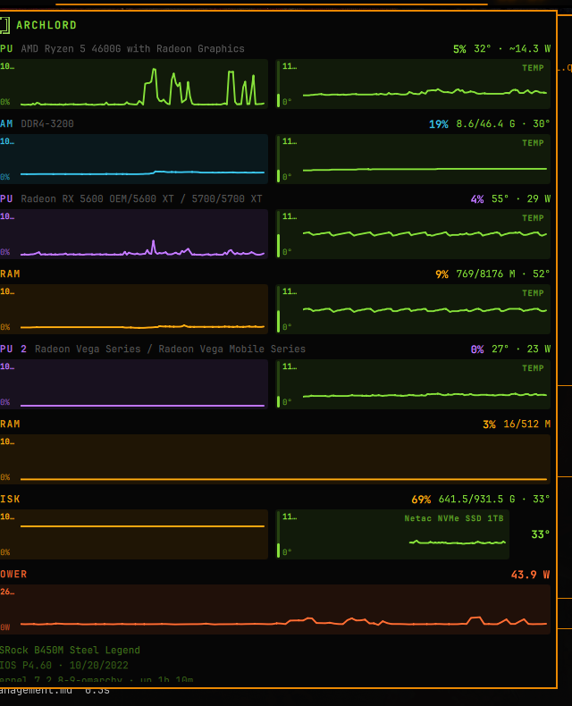

# OhMyStatus

Local stats on the [Omarchy](https://omarchy.org/) bar. Click the chip for
side-by-side line charts: usage next to temperature for CPU, RAM, GPU and VRAM,
plus power. Disk shows used space and the current temperature of each drive.

<p align="center">
  
</p>

## Install

```bash
omarchy plugin add https://github.com/Gedankenn/OhMyStatus.git --enable
```

If it does not appear on the bar:

```bash
omarchy plugin enable ohmystatus --section center
```

## Use

| Input | Action |
| --- | --- |
| Left click | Open popup |
| Middle click | Refresh now |

History lives in `$XDG_RUNTIME_DIR/ohmystatus.<hostname>.hist.json` for the
session. A reboot clears it.

GPU watts come from the driver PPT sensor when it exists. CPU watts use RAPL if
readable, otherwise TDP × utilization. Totals are not wall/PSU draw.

Drive temperature is read per disk from `nvme` / `drivetemp` hwmon.

## License

MIT
